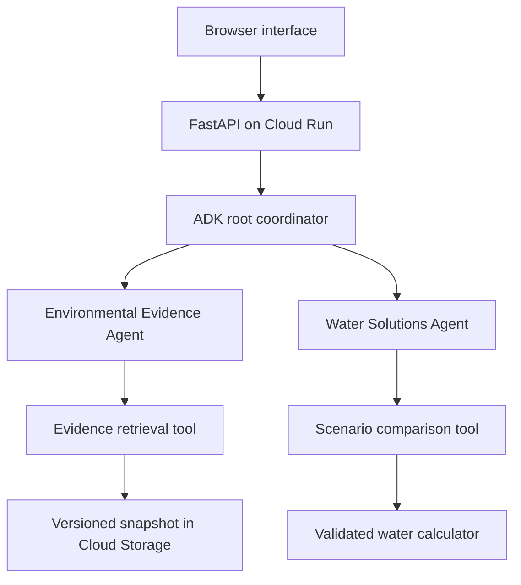

# AquaSustain AI

Evidence-grounded water planning for proposed data centres in India.

AquaSustain combines published groundwater records, transparent water-demand scenarios and Google ADK specialist agents. Users select locations, compare design assumptions, review cited findings and obtain a proposed water-stewardship plan with owners, prerequisites and KPIs.

**Theme:** Sustainability & Social Impact.

## Demonstration links

- **Live application:** https://aqua-sustain-730472785313.asia-south1.run.app
- **Source code:** https://github.com/KalraAkshay/aquasustain-ai

The deployment URL was provided by the project team. Live agent acceptance results must be verified separately.

## User workflow

1. Select a state and district using the India map and filtered district list.
2. Set IT capacity, average load, water usage effectiveness and reclaimed-water share.
3. Request official evidence, design advice or a full assessment.
4. Inspect the actual agent/tool execution trace and source-linked findings.
5. Review proposed actions, add stakeholder feedback and generate a revised assessment.
6. Download the factual brief or the agent assessment with its trace.

## Agent architecture



The root uses AgentTool wrappers to invoke two specialist LlmAgents. Evidence-only and design-only requests invoke the relevant specialist. A full assessment retrieves evidence before solution planning. Both business tools bind to validated request data. Gemini explains findings and proposes actions; the calculator supplies numerical results.

Final validation checks JSON structure, allowed citation references and the required tool-execution route. It cannot guarantee that generated prose correctly interprets every fact; users must review sources and feasibility.

## Google Cloud stack

| Purpose | Implementation |
|---|---|
| Agent orchestration | Google ADK |
| Model inference | Gemini through Google Cloud |
| Application hosting | Cloud Run |
| Versioned evidence | Cloud Storage |
| Container build and storage | Cloud Build and Artifact Registry |
| Authentication | Application Default Credentials locally; runtime service account on Cloud Run |
| Logs | Structured application events in Cloud Logging |
| Application | Python FastAPI, HTML/CSS/JavaScript |

The deployment script creates this Cloud Run architecture. Agents run inside one application service; this project does not require Agent Engine registration. No BigQuery, live sensor network or government-web crawler is claimed.

## Local setup

Python 3.12:

```bash
python3 -m venv .venv
source .venv/bin/activate
pip install -r requirements.txt
cp .env.example .env.local
```

Edit `.env.local` with your project and a supported Gemini model ID. The supplied example reflects the original team's project; replace it when using another project. Never store credentials or private keys in this file. The app loads it automatically; exported environment variables take precedence.

Use Google Cloud Application Default Credentials with model access. Then:

```bash
python scripts/check_agents.py
bash scripts/start_local.sh
```

The live check may make multiple billable model calls. Open http://localhost:8081 or Cloud Shell Web Preview on port 8081. If that port is occupied, use `PORT=8082 bash scripts/start_local.sh`.

Map selection, curated evidence and calculations work without a live model. The application reports missing configuration rather than showing fabricated AI output. Feedback is request-scoped and not retained as long-term memory.

## Deploy and verify

```bash
export AQUA_PROJECT_ID='your-project-id'
export AQUA_MODEL_ID='your-supported-gemini-model-id'
export AQUA_MODEL_LOCATION='global'
export AQUA_REGION='asia-south1'
bash scripts/deploy.sh
```

The script creates billable resources and permits unauthenticated access to the prototype. It sets up dedicated runtime/build identities, uploads a versioned evidence snapshot and deploys a Cloud Run service. Caller permissions and organization policy must allow these operations.

After deployment:

```bash
python scripts/verify_submission.py 'https://your-service.run.app' --agents
```

This checks public application access, the release, reference calculations, a live ADK response and both business tools. Also review the actual UI, sources and action feasibility in a browser. `/health` alone does not prove successful model inference.

## Evidence and calculations

The packaged CGWB 2025 snapshot contains 36 states/UTs, 709 report district entries and 14 category-only Ludhiana assessment-unit records. Coverage follows the report's assessed geography. Three district extraction stages are unusable and excluded from numeric ordering. Source locators, extraction audit and attribution are in [docs/DATA.md](docs/DATA.md).

Water-demand equations:

- Annual IT energy (kWh) = IT capacity (MW) × 1,000 × average load × 8,760.
- Onsite water consumption (m³) = annual IT energy × WUE (L/kWh) ÷ 1,000.
- Freshwater consumption (m³) = onsite consumption × (1 − reclaimed fraction).

The default hypothetical scenario models 168,192 versus 42,048 m³/year of freshwater, a 75% reduction. It is not measured or achieved savings. The model excludes seasonal peaks and electricity-related water. Location changes do not automatically alter WUE.

## Validation and limits

81 automated tests passed in the build environment. They include actual ADK delegation and tool execution with a scripted model, numerical checks, evidence integrity, route enforcement and rejection of invented citation keys. Dependency consistency and DOM interaction checks passed. Live ADK and deployed-service verification must be recorded separately; mocked model tests do not establish live reliability.

```bash
pip install -r requirements-dev.txt
python -m pytest -q
```

The workflow has a 180-second total limit, a 60-second timeout per Gemini request and 8,192 output tokens per model response. Each request can involve multiple model calls. Request limits and Cloud Run instance limits do not constitute a global cost cap. Third-party deprecation warnings are documented in [docs/VALIDATION.md](docs/VALIDATION.md).

The MVP does not prove contamination, fish mortality, marine/ecological damage, livelihood losses, legal CSR eligibility or site suitability. It produces draft proposals for engineering and stakeholder review. Actions are not approved or executed automatically.

## Repository guide

- `app/agents/workflow.py`: root, specialists, business tools, trace and validation.
- `prompts/`: shared and specialist instructions.
- `app/calculator.py`: deterministic scenario calculations.
- `app/evidence.py`: curated records and claim ledger.
- `app/static/`: map, scenario interface and assessment view.
- `docs/AGENT_ARCHITECTURE.md`: full architecture and contracts.
- `docs/DATA.md`: source provenance and map attribution.
- `scripts/deploy.sh`: Google Cloud deployment.
- `scripts/verify_submission.py`: deployed-service acceptance check.

## Next validation

Review action feasibility with planners; collect parcel-matched records and verified supply information; evaluate generated interpretations against official sources. Richer environmental observations are future work and must not be inferred from aggregate groundwater records.
